# Entity-Relationship Diagram (normal schema)

Generated by `scripts/make_docs.py` from `databases/cargo_normal.db`. Relationship labels name the foreign-key column. The mixed and cryptic schemas have exactly the same structure with renamed identifiers (see [schema_variants.md](schema_variants.md)).

```mermaid
erDiagram
    airports ||--o{ airlines : "home_hub_airport_id"
    airports ||--o{ aircraft : "home_airport_id"
    airlines ||--o{ aircraft : "airline_id"
    aircraft_types ||--o{ aircraft : "type_id"
    airports ||--o{ warehouses : "airport_id"
    aircraft_types |o--o{ crew_members : "type_rating_id"
    airports ||--o{ crew_members : "base_airport_id"
    airlines ||--o{ crew_members : "airline_id"
    airports ||--o{ flights : "destination_airport_id"
    airports ||--o{ flights : "origin_airport_id"
    aircraft ||--o{ flights : "aircraft_id"
    crew_members ||--o{ crew_assignments : "crew_member_id"
    flights ||--o{ crew_assignments : "flight_id"
    airports ||--o{ maintenance_records : "airport_id"
    aircraft ||--o{ maintenance_records : "aircraft_id"
    airports ||--o{ fuel_uplifts : "airport_id"
    flights ||--o| fuel_uplifts : "flight_id"
    airports ||--o{ shipments : "destination_airport_id"
    airports ||--o{ shipments : "origin_airport_id"
    customers ||--o{ shipments : "customer_id"
    flights ||--o{ flight_cargo : "flight_id"
    shipments ||--o{ flight_cargo : "shipment_id"
    shipments ||--o| invoices : "shipment_id"
    customers ||--o{ payments : "customer_id"
    invoices ||--o{ payments : "invoice_id"
    warehouses |o--o{ incidents : "warehouse_id"
    airports ||--o{ incidents : "airport_id"
    flight_cargo ||--o{ incidents : "flight_cargo_id"
    customers ||--o{ insurance_claims : "customer_id"
    incidents ||--o| insurance_claims : "incident_id"
    warehouses ||--o{ customs_declarations : "warehouse_id"
    shipments ||--o{ customs_declarations : "shipment_id"
    warehouses |o--o{ tracking_events : "warehouse_id"
    airports ||--o{ tracking_events : "airport_id"
    flights |o--o{ tracking_events : "flight_id"
    shipments ||--o{ tracking_events : "shipment_id"

    benchmark_meta {
        text meta_key PK,UK
        text meta_value
    }
    airports {
        integer airport_id PK
        text iata_code UK
        text icao_code UK
        text name
        text city
        text country
        text region
        text timezone
        real latitude
        real longitude
        integer elevation_m
        integer runway_count
        integer longest_runway_m
        integer is_cargo_hub
        integer annual_cargo_capacity_t
        integer has_24h_customs
        integer night_curfew
    }
    airlines {
        integer airline_id PK
        text iata_code UK
        text icao_code UK
        text name UK
        text callsign UK
        text country
        text headquarters_city
        integer founded_year
        integer home_hub_airport_id FK
        text alliance
        integer is_cargo_only
        text aoc_number UK
        text website
        text contact_email
    }
    aircraft_types {
        integer type_id PK
        text model UK
        text icao_type_designator UK
        text manufacturer
        integer engine_count
        text engine_model
        integer max_payload_kg
        real max_volume_m3
        integer max_range_km
        integer cruise_speed_kmh
        integer max_takeoff_weight_kg
        integer operating_empty_weight_kg
        integer fuel_capacity_kg
        integer fuel_burn_kg_per_hour
        integer main_deck_positions
        real wingspan_m
    }
    aircraft {
        integer aircraft_id PK
        text tail_number UK
        text serial_number UK
        integer type_id FK
        integer airline_id FK
        integer home_airport_id FK
        text registration_country
        integer year_manufactured
        text delivery_date
        text ownership
        text lessor_name
        text lease_end_date
        integer total_flight_hours
        integer total_cycles
        text last_heavy_check_date
        text status
    }
    customers {
        integer customer_id PK
        text account_code UK
        text name
        text customer_type
        text country
        text city
        text address_line
        text postal_code
        text contact_name
        text contact_email
        text contact_phone
        text website
        text sales_region
        real credit_limit_usd
        integer payment_terms_days
        integer is_known_shipper
        text loyalty_tier
        text created_date
    }
    warehouses {
        integer warehouse_id PK
        text warehouse_code UK
        integer airport_id FK
        text operator_name
        text warehouse_type
        integer floor_area_m2
        integer capacity_tonnes
        integer cold_room_count
        real min_temperature_c
        integer dock_door_count
        integer has_dg_area
        integer is_bonded
        text security_level
        integer operates_24h
        integer opened_year
        real monthly_rent_usd
    }
    crew_members {
        integer crew_member_id PK
        text employee_number UK
        text first_name
        text last_name
        text email UK
        integer airline_id FK
        integer base_airport_id FK
        text crew_rank
        integer type_rating_id FK
        text license_number UK
        text license_expiry_date
        text medical_expiry_date
        text hire_date
        integer seniority_number
        integer total_flight_hours
        integer is_active
    }
    flights {
        integer flight_id PK
        text flight_number
        text flight_type
        integer aircraft_id FK
        integer origin_airport_id FK
        integer destination_airport_id FK
        text scheduled_departure
        text scheduled_arrival
        text actual_departure
        text actual_arrival
        text departure_stand
        text arrival_stand
        integer distance_km
        integer planned_cruise_altitude_ft
        integer takeoff_weight_kg
        text weather_at_departure
        text delay_code
        text cancellation_reason
        text status
    }
    crew_assignments {
        integer assignment_id PK
        integer flight_id FK
        integer crew_member_id FK
        text duty_role
        integer is_pilot_flying
        text report_time
        text release_time
        integer block_minutes_credited
        integer rest_minutes_before
        real per_diem_usd
        integer hotel_required
        text assignment_status
    }
    maintenance_records {
        integer maintenance_id PK
        text work_order_number UK
        integer aircraft_id FK
        integer airport_id FK
        text check_type
        integer ata_chapter
        text mro_provider
        text start_time
        text end_time
        real labor_hours
        real parts_cost_usd
        real labor_cost_usd
        integer deferred_items_count
        integer is_aog
        text next_due_date
        text status
    }
    fuel_uplifts {
        integer fuel_uplift_id PK
        text fuel_ticket_number UK
        integer flight_id FK,UK
        integer airport_id FK
        text supplier_name
        text fuel_type
        text delivery_method
        text uplift_time
        integer quantity_kg
        integer quantity_litres
        real density_kg_per_l
        real price_usd_per_litre
        real total_cost_usd
        real saf_blend_pct
        integer fuel_burned_kg
        integer co2_emissions_kg
    }
    shipments {
        integer shipment_id PK
        text awb_number UK
        integer customer_id FK
        text customer_reference
        text consignee_name
        integer origin_airport_id FK
        integer destination_airport_id FK
        text booking_date
        text requested_delivery_date
        text service_level
        text commodity_category
        integer pieces
        real total_weight_kg
        real total_volume_m3
        real chargeable_weight_kg
        real declared_value_usd
        integer is_dangerous_goods
        text dg_class
        integer is_temperature_controlled
        real min_temperature_c
        real max_temperature_c
        text status
    }
    flight_cargo {
        integer flight_cargo_id PK
        integer shipment_id FK
        integer flight_id FK
        integer leg_number
        text uld_type
        text uld_number
        text deck
        text position_code
        integer load_sequence
        text seal_number
        text loaded_at
        text leg_status
    }
    invoices {
        integer invoice_id PK
        text invoice_number UK
        integer shipment_id FK,UK
        text issued_date
        text due_date
        integer payment_terms_days
        real freight_charge_usd
        real fuel_surcharge_usd
        real security_fee_usd
        real handling_fee_usd
        real dg_surcharge_usd
        real discount_usd
        real amount_usd
        text sent_via
        text status
    }
    payments {
        integer payment_id PK
        text payment_reference UK
        integer invoice_id FK
        integer customer_id FK
        text payment_date
        real amount_usd
        text original_currency
        real original_amount
        real exchange_rate_to_usd
        text method
        real bank_charges_usd
        integer is_reconciled
    }
    incidents {
        integer incident_id PK
        integer flight_cargo_id FK
        integer airport_id FK
        integer warehouse_id FK
        text incident_type
        text severity
        text root_cause
        text reported_by
        text reported_at
        integer pieces_affected
        integer delay_minutes
        real claim_amount_usd
        text corrective_action
        integer resolved
        text resolved_at
    }
    insurance_claims {
        integer claim_id PK
        text claim_number UK
        integer incident_id FK,UK
        integer customer_id FK
        text policy_number
        text insurer_name
        text coverage_type
        text filed_date
        real claimed_amount_usd
        real deductible_usd
        real approved_amount_usd
        text status
        text decision_date
        text rejection_reason
        text settlement_date
        text adjuster_name
    }
    customs_declarations {
        integer declaration_id PK
        text declaration_number UK
        integer shipment_id FK
        integer warehouse_id FK
        text declaration_type
        text customs_country
        text hs_code
        text goods_description
        real customs_value_usd
        real duty_rate_pct
        real duty_amount_usd
        real vat_amount_usd
        text broker_name
        integer inspection_required
        text inspection_result
        text submitted_at
        text cleared_at
        text status
    }
    tracking_events {
        integer event_id PK
        integer shipment_id FK
        integer flight_id FK
        integer airport_id FK
        integer warehouse_id FK
        text event_code
        text event_time
        integer pieces
        real weight_kg
        real temperature_c
        text recorded_by
        text scanner_id
    }
```

`benchmark_meta(meta_key, meta_value)` is a stand-alone helper table holding the dataset's as-of timestamp (`2025-12-20 00:00:00`), the generator seed and the schema version.
